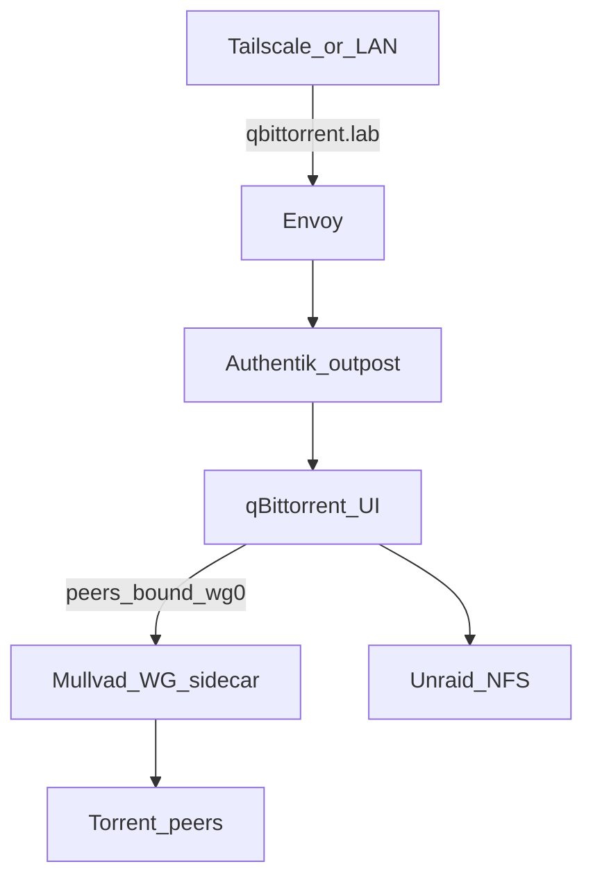

# Media stack (*arr + qBittorrent + Jellyfin + Seerr)

**Live on Talos `prd`** under [`clusters/prd/apps/media/`](../../clusters/prd/apps/media/) — configs copied from the Proxmox arr VM (not fresh installs). **arr VM 101 is stopped** (`onboot=0`); `arr.lab` / `arr.homelab.com` DNS retired.

| App | Auth | Data |
|-----|------|------|
| qBittorrent, Sonarr ×2, Prowlarr, Cleanuparr, Unmanic | **Authentik Proxy** ([Sonarr guide](https://integrations.goauthentik.io/media/sonarr/)) | Shared CNPG **`media-pg`** (*arr + Cleanuparr + Seerr); Unmanic SQLite on iSCSI; NFS libraries/downloads |
| Jellyfin (`10.11.11`) | Envoy → Service (native Jellyfin accounts) | SQLite on iSCSI config PVC; NFS `/anime` + `/tv` (read-only). GPU notes: [gpu](gpu.md) |
| Seerr (`v3.4.1`) | Envoy → Service (Jellyfin login) | CNPG DB `seerr` on **`media-pg`**; config PVC on iSCSI |

## Runtime shape

| Piece | Where |
|-------|--------|
| Pods | namespace `media` — qBit + Mullvad WG sidecar, Sonarr anime/TV, Prowlarr, Jellyfin, Seerr, Cleanuparr, Unmanic, `media-pg` |
| Libraries / downloads | One scarif NFS static PV for parent `/mnt/disks/ZXA0VZBA/media`; *arr / qBit / Cleanuparr mount it at `/home/data`; Jellyfin + Unmanic use `subPath` for `anime` / `tv`; writers `PUID=99` / `PGID=100`; Jellyfin UID 1000 RO |
| Config | iSCSI PVCs (copied from arr); Jellyfin also uses `emptyDir` for `/cache`; Seerr + Cleanuparr config PVCs (Cleanuparr keys/logs only; app DB on `media-pg`); Unmanic config + remux cache on iSCSI |
| Browser URLs (*arr / qBit / Cleanuparr / Unmanic) | Envoy → **Authentik embedded outpost** → Services ([`resources-media-routes.yaml`](../../clusters/prd/apps/authentik/resources-media-routes.yaml)) |
| Browser URL (Jellyfin / Seerr) | Envoy → `jellyfin.media` `:8096` / `seerr.media` `:5055` |
| API / Homepage | Authentik `skip_path_regex` on `/api` (and `/feed` for Sonarr); Cleanuparr `/health` for Kuma; Jellyfin/Seerr widgets hit app APIs directly |
| Native UI auth | `AuthenticationMethod=External` (*arr); qBit `AuthSubnetWhitelist` for cluster CIDRs; Cleanuparr “disable auth for local addresses”; Jellyfin + Seerr (via Jellyfin) native accounts |

## NFS UID (scarif + writers)

Unraid NFS squashes to `nobody:users` (`99:100`); every writer must match. Details: [storage — NFS permissions](storage.md#nfs-permissions-uid--squash).

```bash
chown -R nobody:users /mnt/disks/ZXA0VZBA/media
chmod -R ug+rwX,o+rX /mnt/disks/ZXA0VZBA/media
```

k8s Deployments use **`PUID=99` / `PGID=100`** (`fsGroup: 100`). One static NFS PV mounts the existing parent tree (not dynamic `scarif-nfs` subdirs, not three sibling PVs).

### Why one parent mount

Sibling NFS PVs for `media/anime`, `media/tv`, and `media/downloads` were separate filesystems inside the pod even though they sit on the same Unraid disk. Sonarr then copied on import instead of hardlinking. The parent PV exports `/mnt/disks/ZXA0VZBA/media` once; `/home/data/anime`, `/home/data/tv`, and `/home/data/downloads` share that mount. Sonarr root folders stay `/home/data/anime` and `/home/data/tv`.

Cleanuparr **Unlinked Downloads** is enabled via `cleanuparr-configure`: move to category `cleanuparr-unlinked`, then a seeding rule deletes those torrents and their source files. New imports hardlink (`nlink` ≥ 2) and stay. Pre-cutover copy-imports are removed on purpose. Orphaned Files remains the downloads disk cleanup job for files with no torrent.

Cutover steps (Retain + claimRef, short downtime, `stat` check): [`clusters/prd/apps/media/README.md`](../../clusters/prd/apps/media/README.md) § Hardlink cutover.

## Config + wiring

Configs live on iSCSI PVCs (originally copied from the arr VM). Steady-state wiring is owned by Argo PostSync configure Jobs under [`clusters/prd/apps/media/`](../../clusters/prd/apps/media/) (`qbittorrent-configure`, `sonarr-anime-configure`, `sonarr-tv-configure`, `prowlarr-configure`, `seerr-configure`, plus Cleanuparr / Unmanic / Recyclarr):

1. qBit → Network interface **`wg0`**; WebUI port **8080**; categories for Sonarr + Cleanuparr
2. Sonarr download client → `qbittorrent.media.svc.cluster.local:8080` (per-instance Job)
3. Prowlarr apps → `sonarr-anime` / `sonarr-tv` in-cluster Services (`fullSync`)
4. Sonarr **indexers** → synced from Prowlarr (`http://prowlarr.media.svc.cluster.local:9696/…`)
5. Cleanuparr → both Sonarrs + qBit over in-cluster DNS; mounts parent at `/home/data` for orphan scans under `/home/data/downloads` (see [`clusters/prd/apps/media/README.md`](../../clusters/prd/apps/media/README.md) § Cleanuparr)
6. Unmanic remuxes libraries in place at `/library/{anime,tv}` (`subPath` from the parent PVC); PostSync Job `unmanic-configure` applies libraries + `keep_stream_by_language` (remux-only, no H.265)
7. *arr / qBit / Cleanuparr mount the parent at `/home/data` (Compose paths for root folders and downloads unchanged)
8. Jellyfin mounts: `/anime`, `/tv` via `subPath`, plus `/config` (Compose paths preserved)
9. Seerr → Jellyfin + both Sonarrs over in-cluster DNS (`seerr-configure`)

### Postgres (*arr + Seerr)

Shared CNPG Cluster **`media-pg`** in namespace `media` (iSCSI). 1Password **`prd Media Postgres`**.

| App | Main DB | Log DB |
|-----|---------|--------|
| Sonarr anime | `sonarr_anime_main` | `sonarr_anime_log` |
| Sonarr TV | `sonarr_tv_main` | `sonarr_tv_log` |
| Prowlarr | `prowlarr_main` | `prowlarr_log` |
| Seerr | `seerr` | — |
| Cleanuparr | `cleanuparr` (schemas `data` / `events` / `users`) | — |

Init containers upsert `Postgres*` + `AuthenticationMethod=External` for *arr. Seerr uses `DB_*` env vars. qBittorrent stays on disk (no Postgres).

### Seerr integrations

`seerr-configure` applies Jellyfin + both Sonarrs over **in-cluster** Service DNS so traffic skips Authentik Proxy. Prowlarr is not a Seerr integration (Sonarr owns indexers). No Radarr in this lab yet. First browser visit still completes the Jellyfin login wizard once; API keys stay in Homelab **`prd Homepage media API keys`**.

## qBittorrent + VPN

| Traffic | Requirement |
|---------|-------------|
| BitTorrent peers (up/down) | Out **Mullvad WireGuard** (sidecar `wg0`; qBit binds to it) |
| Web UI | **`https://qbittorrent.lab.jacobdrury.com`** — Authentik Proxy → qBit Service |

Mullvad conf in 1Password **`prd Mullvad WireGuard`**. Sidecar runs `wg-quick` with **`Table = off`** so UI/DNS stay on eth0. **Gluetun is not used on k8s.** Sidecar also serves **`:8081`** (handshake + `am.i.mullvad.net` via `wg0`) for Uptime Kuma → Discord (`prd Discord Lab Alerts`).



## Monitoring

Uptime Kuma probes Authentik **skip paths** that reach the app (`/api` → 401 for *arr; qBit `/api/v2/app/version` → 200), not the unauthenticated `/` redirect to Authentik. Jellyfin monitor hits `/` (native auth, no Authentik). Seerr monitor hits `/api/v1/status` (public). See [`infrastructure/uptime-kuma/monitors.tf`](../../infrastructure/uptime-kuma/monitors.tf).
