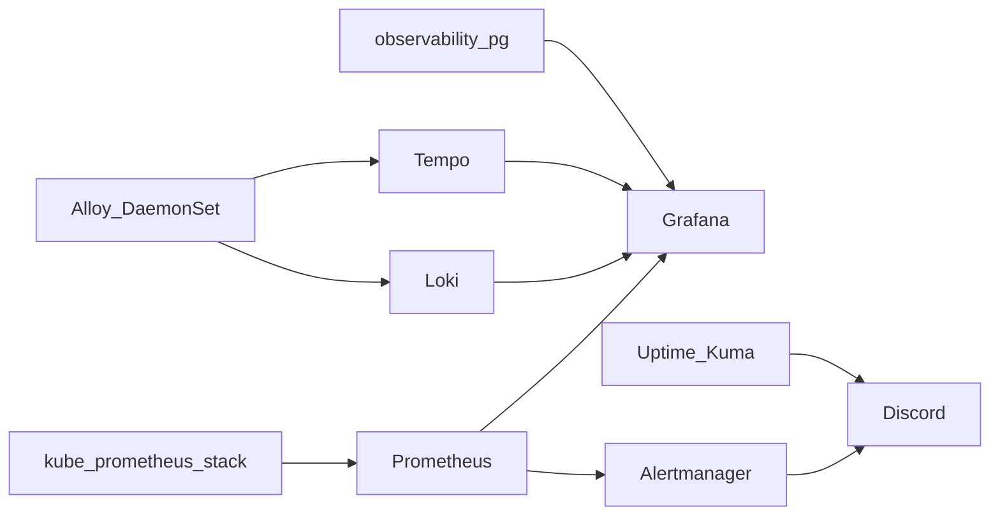

# Observability

Metrics, logs, and traces for `prd`. GitOps under [`clusters/prd/platform/observability/`](../../clusters/prd/platform/observability/).

## Stack

| Signal | Component | Notes |
|--------|-----------|--------|
| Metrics | Prometheus (kube-prometheus-stack) | 7d retention, `scarif-iscsi` PVC |
| Alerts | Alertmanager → Discord | Same webhook as Kuma (`prd Discord Lab Alerts`) |
| UI | Grafana | Authentik OIDC; Postgres on CNPG `observability-pg` |
| Logs | Loki SingleBinary | 7d retention, filesystem PVC |
| Traces | Tempo monolithic | 3d retention, local PVC |
| Collect | Grafana Alloy DaemonSet | Pod logs → Loki; OTLP → Tempo |

Still separate: **metrics-server** (Metrics API / Homepage / HPA) and **Uptime Kuma** (outside-in probes). They are not replaced.

## URLs

| What | URL |
|------|-----|
| Grafana | `https://grafana.lab.jacobdrury.com` |
| Prometheus / Loki / Tempo / Alertmanager | in-cluster only |

## Auth

Grafana uses Authentik OIDC (blueprint `blueprints-grafana.yaml`). Add your user to group **Grafana Admins** for Admin role; others get Viewer. Break-glass local admin from 1Password `prd Grafana admin`.

## Alerting

Alertmanager owns Prometheus-shaped alerts only. Uptime Kuma and app-native notifiers (e.g. Sonarr) keep their own Discord paths aimed at the same webhook. Do not force every lab notifier through Alertmanager.

## Secrets

| 1Password item | Purpose |
|----------------|---------|
| `prd Observability Postgres` | CNPG owner password (username fixed to `grafana`) |
| `prd Grafana OIDC` | OAuth client secret |
| `prd Grafana admin` | Grafana break-glass password |
| `prd Discord Lab Alerts` | Alertmanager Discord webhook (shared with Kuma) |

## OTLP

Apps can send traces to `alloy.monitoring.svc.cluster.local:4317` (gRPC) or `:4318` (HTTP). No per-app instrumentation in the first cut; the collector is receive-ready.

## Ops notes

- Prefer scheduling stateful pods on **naboo** (soft affinity) while it exists; Phase 4 drops naboo.
- Talos/Cilium: kube-etcd / scheduler / controller-manager / kube-proxy scrapes disabled (would stay red).
- After merge: create 1Password items → Argo sync → `moon run cloudflare:apply` → `moon run uptime-kuma:apply` → join **Grafana Admins**.
